# Autoencoders in PyTorch

## Installation

Requires Python **3.13 or newer**. This project uses [uv](https://docs.astral.sh/uv/) to manage dependencies and run scripts.

Install the dependencies from the repository root:

```bash
uv sync
```

To install without development dependencies:

```bash
uv sync --no-dev
```

## About

A small PyTorch project for exploring image reconstruction and learned latent representations with autoencoders and variational autoencoders.

The repository includes four models:

- **MLP Autoencoder** - a fully connected encoder and decoder.
- **CNN Autoencoder** - a convolutional encoder and decoder with spatial latent representations.
- **MLP Variational Autoencoder** - a fully connected VAE with a sampled latent vector.
- **CNN Variational Autoencoder** - a convolutional VAE with sampled spatial latents.

The data pipeline supports **MNIST, Fashion-MNIST and CIFAR-10**. Encoders and decoders are separate from the training modules, while a shared trainer handles training, validation, metrics, checkpoints and visualizations. Run settings use Pydantic configuration models.

Reconstruction metrics include MSE, MAE, SSIM and PSNR, with optional LPIPS and DISTS. VAE training combines a reconstruction loss with a weighted KL divergence term.

## Results

One selected MNIST run for each model, plus two additional MLP runs with a **2D latent space**, shown across training epochs **1-200**. The animations sample epochs more densely at the beginning and pause on the final result.

The comparison below shows the same validation example for each digit **0–9**, with inputs in the first row and reconstructions from **epoch 200** for all six selected models below.

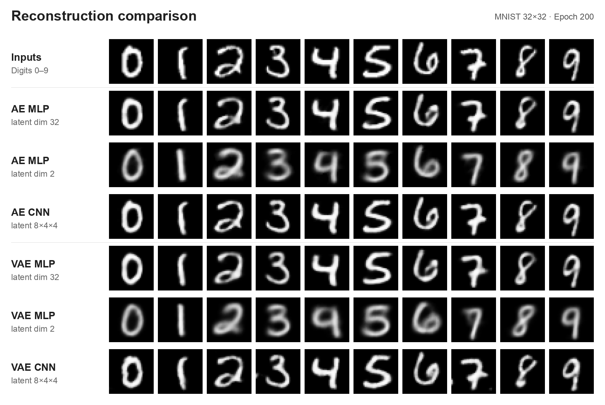

Each reconstruction animation pairs the same validation images on the **left** with their reconstructions on the **right**. Latent animations are colored by digit class. Higher-dimensional latents use a 2D UMAP projection; the runs with `latent_dim=2` show their two coordinates directly. For VAEs, these are the sampled latent representations `z`.

### MLP Autoencoder

[Config](docs/mlp-ae_mnist_mse_latent-dim-32/config.json) · [Initialization log](docs/mlp-ae_mnist_mse_latent-dim-32/logs.log)

| Reconstruction | Latent space |
| --- | --- |
| 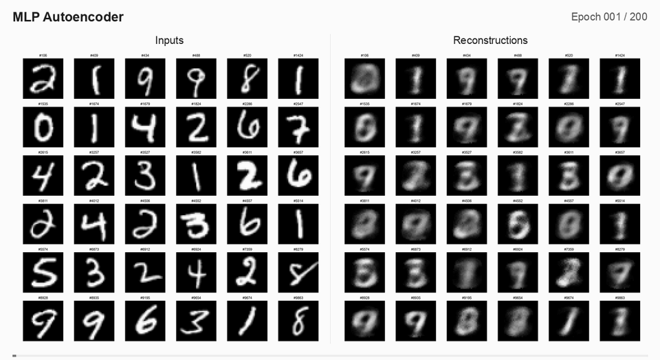 | 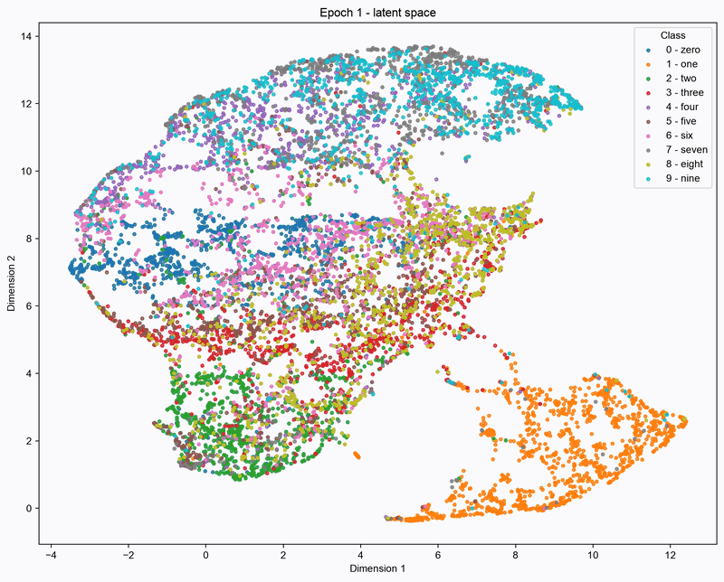 |

### CNN Autoencoder

[Config](docs/cnn-ae_mnist_mse_latent-channels-8/config.json) · [Initialization log](docs/cnn-ae_mnist_mse_latent-channels-8/logs.log)

| Reconstruction | Latent space |
| --- | --- |
| 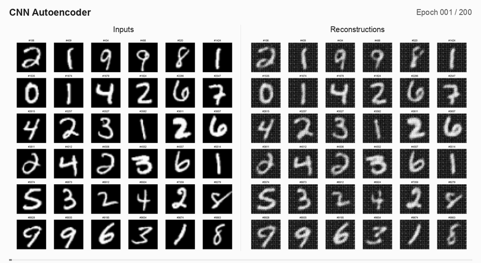 | 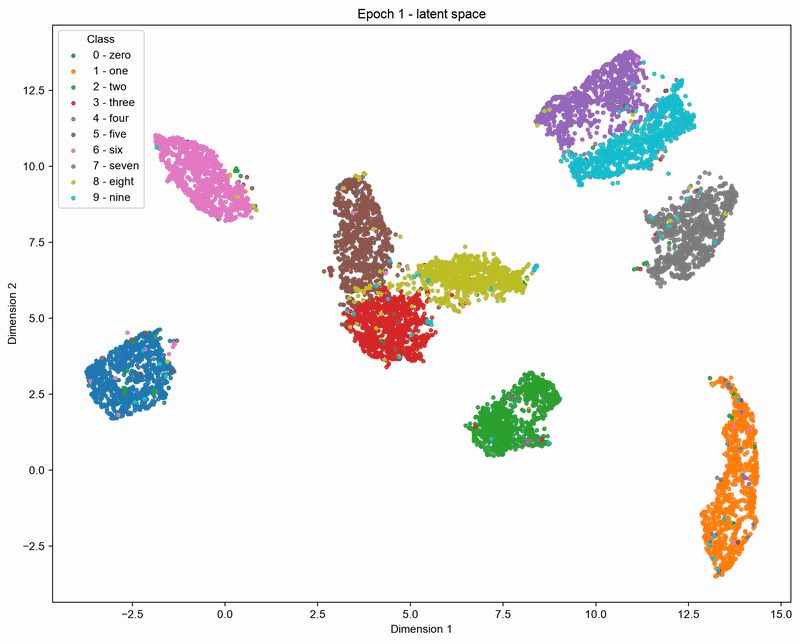 |

### MLP Variational Autoencoder

[Config](docs/mlp-vae_mnist_bce_latent-dim-32_klw-0.3/config.json) · [Initialization log](docs/mlp-vae_mnist_bce_latent-dim-32_klw-0.3/logs.log)

| Reconstruction | Latent space |
| --- | --- |
| 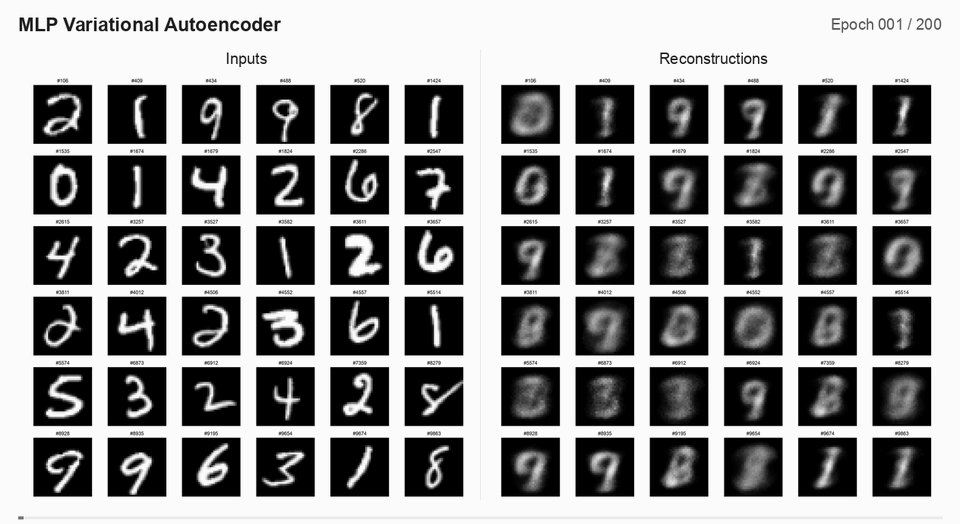 | 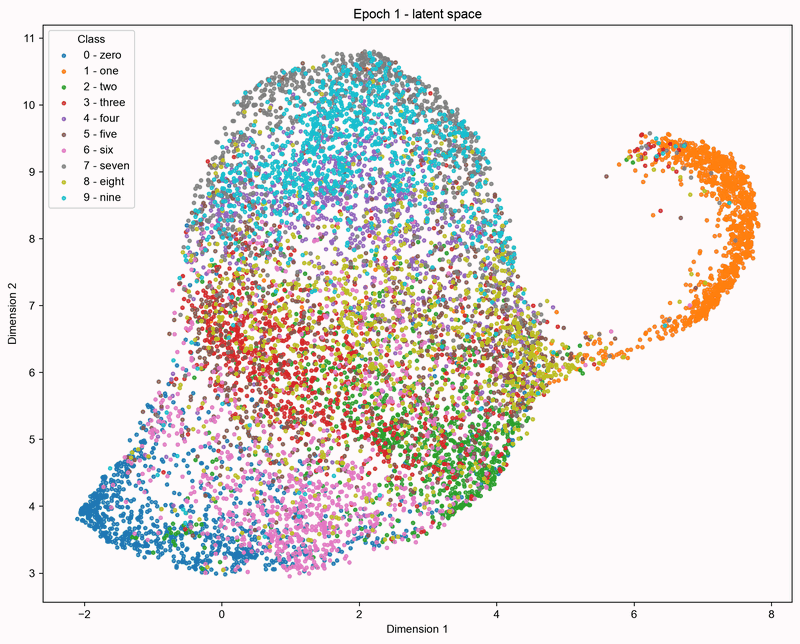 |

### CNN Variational Autoencoder

[Config](docs/cnn-vae_mnist_deep_bce_latent-channels-8_klw-0.3/config.json) · [Initialization log](docs/cnn-vae_mnist_deep_bce_latent-channels-8_klw-0.3/logs.log)

| Reconstruction | Latent space |
| --- | --- |
| 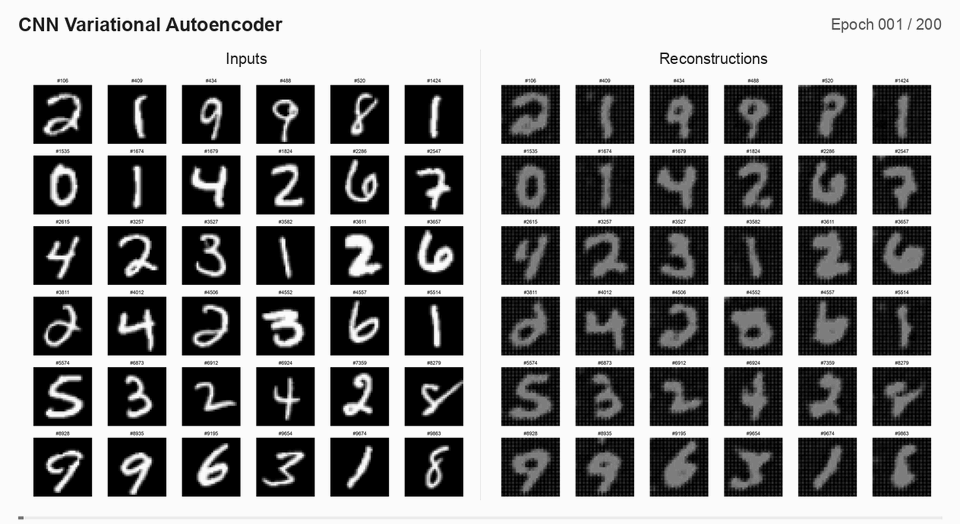 | 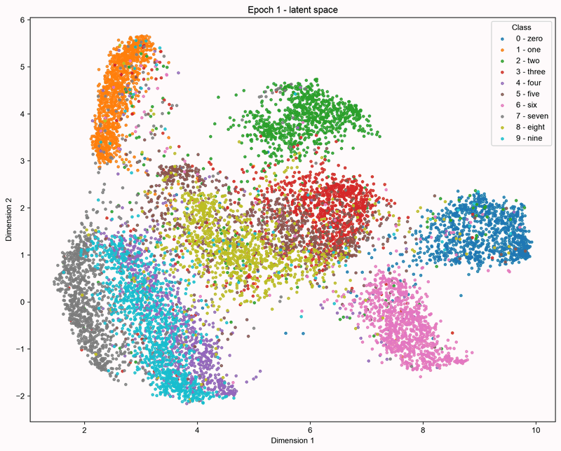 |

UMAP is fitted separately at each epoch, so clusters can rotate or change position between frames. These animations show the organization of each projection; they do not track trajectories in a shared coordinate system.

### MLP Autoencoder (latent dim 2)

[Config](docs/mlp-ae_mnist_mse_latent-dim-2/config.json) · [Initialization log](docs/mlp-ae_mnist_mse_latent-dim-2/logs.log)

| Reconstruction | Latent space |
| --- | --- |
| 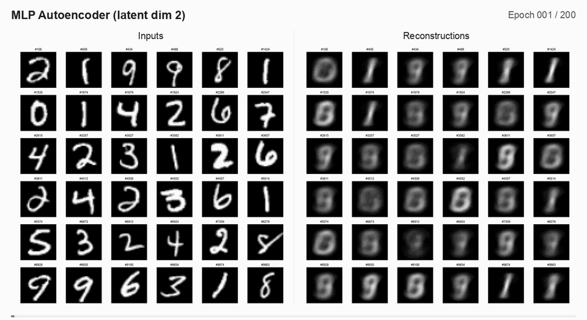 | 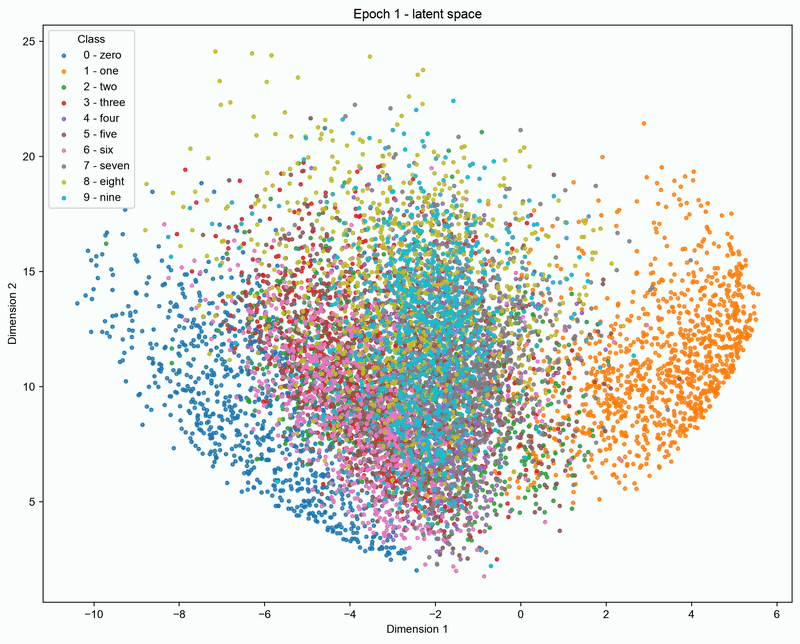 |

### MLP Variational Autoencoder (latent dim 2)

[Config](docs/mlp-vae_mnist_bce_latent-dim-2/config.json) · [Initialization log](docs/mlp-vae_mnist_bce_latent-dim-2/logs.log)

| Reconstruction | Latent space |
| --- | --- |
| 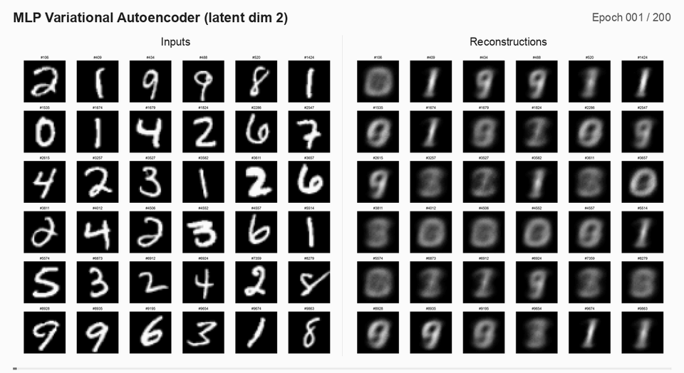 | 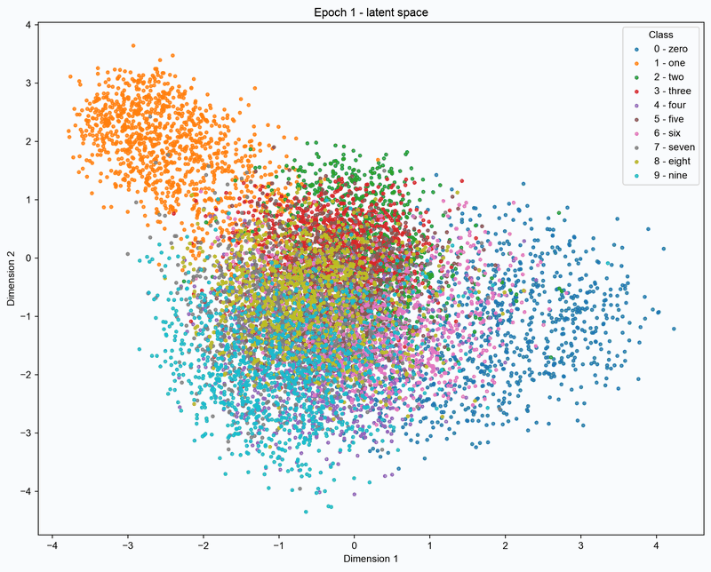 |

### Latent space interpolation

Each tile is generated by decoding a point on a regular **20×20 grid** in the two-dimensional latent space, using the checkpoint from **epoch 200**. Moving horizontally changes `z1`; moving vertically changes `z2`.

The AE grid covers `[-3, 3]` on both axes. The VAE grid covers `[-2, 2]` on both axes.

| MLP Autoencoder | MLP Variational Autoencoder |
| --- | --- |
| 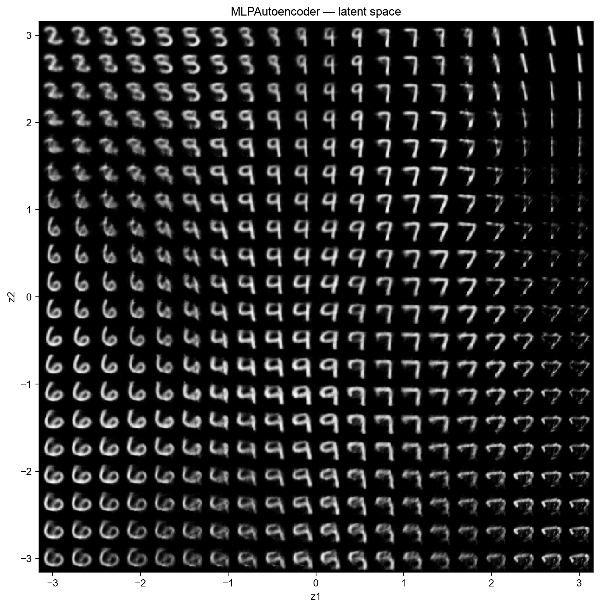 | 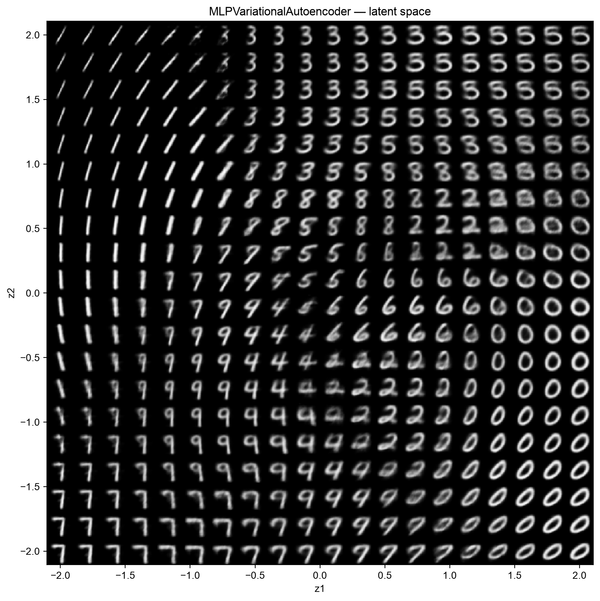 |

Generated with [interpolate_latent_space.py](scripts/visualization/interpolate_latent_space.py).

## Usage

Run a training script from the repository root:

```bash
# Autoencoders
uv run python scripts/training/train_mlp_autoencoder.py
uv run python scripts/training/train_cnn_autoencoder.py

# Variational autoencoders
uv run python scripts/training/train_mlp_vae.py
uv run python scripts/training/train_cnn_vae.py
```

Each script defines its configuration, model, optimizer and loss. Adjust these definitions in the script to choose the dataset and experiment settings.

Training creates a timestamped directory under `runs/` containing:

- `config.json` and `logs.log` - configuration, model details and training logs.
- `metrics.json` - batch metrics for training and validation.
- `metrics_plots/` - training and validation metric curves.
- `results_plots/` - inputs, reconstructions, latent projections and generated images.
- `checkpoints/last.pth` - the latest saved training state.

The `scripts/data/`, `scripts/models/`, `scripts/module/` and `scripts/losses/` directories contain smaller examples for inspecting individual parts of the project.

## Development

### Dependencies

Install the development dependencies:

```bash
uv sync --group dev
```

Or install a specific dependency group defined in `pyproject.toml`:

```bash
uv sync --group <GROUP_NAME>
```

Add a project dependency:

```bash
uv add <PACKAGE_NAME>
```

Add a development dependency:

```bash
uv add --group dev <PACKAGE_NAME>
```

### Versioning

Set the project version:

```bash
uv version <VERSION>
```

Or increment a version component:

```bash
uv version --bump <SEMVER_PART> # e.g. major, minor, patch
```

### Pre-commit

This project uses pre-commit to ensure that the code is formatted correctly.

To install pre-commit, run the following command:

```bash
pre-commit install
```

or

```bash
uv run pre-commit install
```

To run pre-commit on all files, run the following command:

```bash
pre-commit run --all-files
```

or

```bash
uv run pre-commit run --all-files
```
